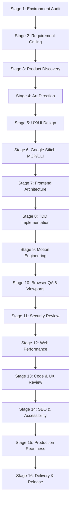

# WORKFLOW: NEW WEBSITE (GREENFIELD)

## 1. Overview
The `NEW_WEBSITE` workflow guides the entire product lifecycle from raw business concept through design, architecture, TDD, motion, browser verification, and security/performance audits to production release.

## 2. Complete 16-Stage Execution Flow

## 3. Stage-by-Stage Detailed Operations

### Stage 1: Environment Audit
- **Agent:** AGENT 01 (Master Orchestrator)
- **Action:** Audit tools (Git, Node.js, Python, Playwright, MCP servers).
- **Artifact:** Environment audit summary.

### Stage 2: Requirement Grilling
- **Agent:** AGENT 02 (Requirement Grilling Specialist)
- **Action:** Socratic interview, 1 question at a time, challenging assumptions.
- **Artifact:** `PROJECT_BRIEF.md`, `REQUIREMENTS.md`, `GLOSSARY.md`.
- **Quality Gate:** **G1 (Requirements)**

### Stage 3: Product Discovery
- **Agent:** AGENT 03 (Product Discovery Specialist)
- **Action:** Define user personas, map user journeys, create IA sitemap.
- **Artifact:** `USER_PERSONAS.md`, `USER_JOURNEYS.md`, `SITEMAP.md`, `ACCEPTANCE_CRITERIA.md`.
- **Quality Gate:** **G2 (Product Discovery)**

### Stage 4: Art Direction
- **Agent:** AGENT 04 (Design Art Director - Taste Skill)
- **Action:** Define anti-slop visual narrative, bespoke font pairings, 60-30-10 palette.
- **Artifact:** `DESIGN_DIRECTION.md`, `DESIGN_TOKENS.json`.
- **Quality Gate:** **G3 (Design Direction)**

### Stage 5: UX/UI Design
- **Agent:** AGENT 05 (UX/UI Designer - Impeccable)
- **Action:** Wireframe component hierarchy, apply Impeccable commands, score usability heuristics.
- **Artifact:** `DESIGN_SPECIFICATION.md`, `UI_CRITIQUE_REPORT.md`.
- **Quality Gate:** **G4 (UX/UI Critique)**

### Stage 6: Google Stitch Design
- **Agent:** AGENT 06 (Google Stitch Design Engineer)
- **Action:** Generate screen variants and export design system via Stitch MCP/CLI.
- **Artifact:** `STITCH_DESIGN_SPEC.md`, `COMPONENT_INVENTORY.md`.
- **Quality Gate:** **G5 (Stitch Design)**

### Stage 7: Frontend Architecture
- **Agent:** AGENT 08 (Frontend Architect)
- **Action:** Select stack, scaffold directory structure, establish state & token pipelines.
- **Artifact:** `ARCHITECTURE.md`.
- **Quality Gate:** **G6 (Frontend Architecture)**

### Stage 8: TDD Implementation
- **Agent:** AGENT 10 (TDD Specialist) & AGENT 09 (Implementation Engineer)
- **Action:** Red-Green-Refactor vertical slices.
- **Artifact:** Automated unit/integration tests, production source code.
- **Quality Gate:** **G7 (TDD Verification)**

### Stage 9: Motion Engineering
- **Agent:** AGENT 07 (Motion Engineer - Emil Kowalski)
- **Action:** Natural spring curves, tactile feedback (<250ms), reduced-motion support.
- **Artifact:** `MOTION_SPECIFICATION.md`.
- **Quality Gate:** **G8 (Motion Quality)**

### Stage 10: Browser QA
- **Agent:** AGENT 11 (Playwright Browser Engineer)
- **Action:** Test all routes and interactions across the 6 mandatory viewports.
- **Artifact:** `BROWSER_QA_REPORT.md`, viewport screenshots.
- **Quality Gate:** **G9 (Browser QA)**

### Stage 11: Security Review
- **Agent:** AGENT 12 (Security Auditor - Addy Osmani)
- **Action:** Threat modeling (STRIDE), OWASP Top 10, secrets scanning.
- **Artifact:** `SECURITY_AUDIT_REPORT.md`.
- **Quality Gate:** **G10 (Security Audit)**

### Stage 12: Web Performance Review
- **Agent:** AGENT 13 (Web Performance Auditor - Addy Osmani)
- **Action:** Core Web Vitals audit (LCP, INP, CLS), static code scan, metric honesty.
- **Artifact:** `PERFORMANCE_AUDIT_REPORT.md`.
- **Quality Gate:** **G11 (Performance Audit)**

### Stage 13: Code & Design Review
- **Agent:** AGENT 15 (Code Reviewer) & AGENT 05 (Impeccable)
- **Action:** Two-dimensional code review + final Impeccable polish pass.
- **Artifact:** `CODE_REVIEW_NOTES.md`.

### Stage 14: SEO & Accessibility
- **Agent:** AGENT 14 (SEO & Accessibility Specialist)
- **Action:** WCAG 2.2 AA verification, heading hierarchy, JSON-LD schema, sitemap.xml.
- **Artifact:** `SEO_REPORT.md`, `ACCESSIBILITY_REPORT.md`.
- **Quality Gate:** **G12 (Accessibility & SEO)**

### Stage 15: Production Readiness
- **Agent:** AGENT 16 (Production Reviewer)
- **Action:** Consolidate G1-G12 gates, audit zero blocking defects.
- **Artifact:** `RELEASE_CHECKLIST.md`.
- **Quality Gate:** **G13 (Production Release)**

### Stage 16: Delivery
- **Agent:** AGENT 01 (Master Orchestrator)
- **Action:** Compile final project release notes, documentation, and deployment package.
- **Artifact:** `RELEASE_NOTES.md`, `ACCEPTANCE_REPORT.md`.
