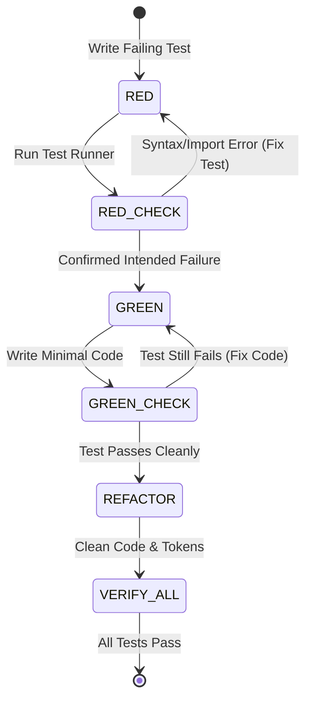

# WORKFLOW: TEST-DRIVEN DEVELOPMENT (TDD)

## 1. Overview
The TDD workflow guarantees that every critical frontend feature and business rule is anchored by independently verifiable automated tests.

## 2. Red-Green-Refactor Protocol

## 3. Mandatory Rules
1. Never commit production code without a pre-existing failing test.
2. Confirm the test fails for the specific behavior expected, not because of missing dependencies.
3. Every test file must reference its matching `REQ-XXX` identifier.
